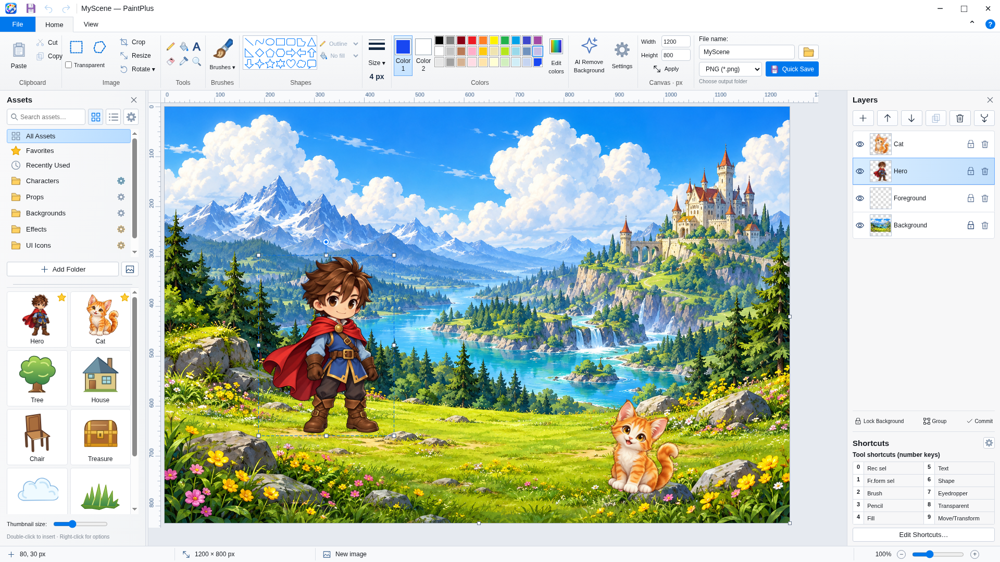

# PaintPlus

A local Windows Paint-style editor with layers, assets, editable shapes and text,
and offline background removal.

**[Download PaintPlus 1.0.8 Setup for Windows](https://github.com/RicFlairIsMyGrandad/MS-Paint-v2-high-effort-/raw/refs/heads/main/downloads/PaintPlus-Setup-1.0.8-x64.exe)**

[Portable EXE](https://github.com/RicFlairIsMyGrandad/MS-Paint-v2-high-effort-/raw/refs/heads/main/downloads/PaintPlus-Portable-1.0.8-x64.exe) · [Complete source ZIP](https://github.com/RicFlairIsMyGrandad/MS-Paint-v2-high-effort-/raw/refs/heads/main/downloads/PaintPlus-Source-1.0.8.zip) · [Full source as TXT](https://github.com/RicFlairIsMyGrandad/MS-Paint-v2-high-effort-/raw/refs/heads/main/downloads/PaintPlus-Full-Source.txt)



## Install

1. Download **PaintPlus-Setup-1.0.8-x64.exe** and run it on a 64-bit Windows 10 or
   Windows 11 computer. The installer can update an existing PaintPlus installation.
2. Choose the installation folder and complete the wizard. Open PaintPlus from
   the desktop or Start menu shortcut. Node.js, Python and other developer tools
   are not required.
3. The executable is unsigned. If Windows displays SmartScreen, review the file
   and its checksum; **More info → Run anyway** is the Windows option for running
   a trusted unsigned application.

The portable EXE runs without installation. Both downloads include the AI model
and runtime. There are no model downloads, online AI calls or telemetry. Uninstall
preserves projects, source assets and user preferences.

Version 1.0.8 includes the earlier blank-window startup fixes: software rendering
on Windows, ASAR-aware resource loading, correct script/WASM types, a visible
startup error screen and diagnostics at `%APPDATA%\PaintPlus\startup.log`.
Hosted Windows checks test the exact release downloads. Results are in
[TESTING.md](docs/TESTING.md); the user's
Home-edition laptop remains a separate hardware check.

## Editing

- Zoom uses only Paint's eleven fixed levels (12.5% through 800%). Image pixels
  stay sharp and selection handles keep a constant screen size. Top and side rulers
  align with canvas pixels at every level and while scrolling.
- New images start at 731 × 411 pixels. Round brush tips are antialiased without repeated stamp buildup or extra endpoint rows. The eraser cursor previews Color 2 in a square of the chosen pixel size with a thin black outline.
- Draw a shape, then move/resize/rotate it or change its outline/fill. Ctrl+Numpad
  Plus/Minus changes the current stroke width by one pixel. Each tool remembers
  its own size; width changes do not add undo steps. Enter commits the shape.
- Drag a text box and type directly on the canvas. The Text ribbon controls
  formatting, line spacing, independent horizontal/vertical bubble padding and
  an optional rounded speech bubble. Background has three exclusive checkboxes: Transparent, White
  (RGB 254/255/255), and Custom; text-colour changes preserve its fill. Select
  words to change their font, point size, colour and style independently; Ctrl+A
  in the box formats all text. Font favorites stay pinned. Six font families are
  bundled alongside the fonts installed on your computer. Finished
  text can be resized and edited while selected. The Text ribbon opens after creating a box; outside confirmation keeps Text selected for the next drag. Bubble outlines retain their creation colour. New bubbles have smaller tails: use
  the Text ribbon sliders for width and attachment position, then drag the blue
  diamond to aim the tip. Corners and the optional grey shadow retain their pixel sizes. Font size has a
  dropdown and supports typing custom values. Ctrl+Enter ends typing; Enter or
  clicking outside confirms the selection as raster pixels. Save a project
  before confirmation to keep text editable.
- Rectangular/free-form selection buttons sit side by side. **8** toggles exact
  Color-2 transparency. Ctrl+A still selects all. Default Paint behavior commits
  a pixel selection when you click outside; Settings also offers persistent mode.
  Every selection has resize/rotate handles; no separate Move tool is needed.
  Right-click offers Cut, Copy, Delete and Cut into new layer. The new layer
  retains the cut content's position. In keyed mode its paper is Color 2;
  in alpha mode the new layer is transparent. Upper layers reveal lower layers
  according to the transparency toggle. A lifted upper-layer area leaves real
  transparency in alpha mode; the bottom canvas and keyed mode use Color 2. Deleting or cutting a floating area
  preserves whatever is painted behind its destination. Selecting and unchanged
  deselection do not create undo actions, clear redo or dirty a saved project. Outside drags confirm the current selection and begin another using the same tool.
  Shift-drag or Shift-arrow stamps a trail; arrows move one pixel per press.
- The Brush picture selects round or the last brush used. The lower arrow opens
  brush choices. Size shows the current width. Right-drag uses Color 2; right-click
  a palette swatch sets Color 2.
- Photo resizing uses original-source Lanczos filtering in the preview and output. Nearest neighbour remains available for pixel art. A scrolled paste starts at the visible canvas corner.
- Shift-click layer rows to select a range, or Ctrl-click individual layers, then
  choose Group (Ctrl+G). Painted pixels and inserted objects move together. Grey
  group headers activate all members; indented child rows activate individual
  layers. Clicking a layer or group does not pre-select canvas content and keeps
  your current tool selected. After choosing a group header, choose Select or Free-form Select to
  select the same canvas region on every visible, unlocked member. Move, resize,
  rotate, flip, cut, copy and delete apply to every selected region. Brush, pencil,
  eraser and fill also link across members with one undo step. New objects go
  on the active layer, and visibility/naming/locking remain individual properties.
  Ungroup with the adjacent button or Ctrl+Shift+G. Stack order is preserved.
- Shapes also includes **Pointing hand line** and **Pointing hand curve**. Drag the
  shaft; curves accept two bend drags or Enter to finish early. The black hand follows
  the endpoint direction. **Hand-drawn wobble** makes the shaft less straight.
- Edit Colors uses the classic two-pane layout with 48 basic swatches, 16
  saved custom slots, hue/saturation and luminance controls, and synchronized
  RGB/HSL fields. The luminance ramp and arrow both drag. The bottom ribbon
  row starts with nine blank custom slots and permanent RGB 24/71/241 blue.
  Click a blank slot to define it. OK applies and saves the colour to the ribbon;
  Add to Custom Colors saves both dialog and ribbon slots. Custom colours
  persist across restart. Cancel preserves the current paint colour.
- Exact 90/180/270-degree rotations preserve hard pixels and alpha, without
  accumulating position drift. Arbitrary-angle rotation can use smoothing.
- Above the asset-layer toggle, check **Use Color 2 as transparency** for exact
  secondary-colour keying or uncheck it for normal alpha transparency. Projects
  save the mode; older projects keep their keyed appearance. The bottom paper
  canvas erases to Color 2; alpha-mode upper layers erase to transparency.
  Double-click a layer name or right-click → Rename layer to edit it in place.
  Eye double-click does not rename. Visibility stays outside undo/redo.
- Ribbon Width/Height + Apply changes canvas boundaries without stretching.
  Larger pastes grow the canvas by default; Settings can retain its dimensions.
- A layer's bin or Delete after clicking its row removes it immediately. Ctrl+Z
  restores it. Locked layers must be unlocked first. Ctrl+Z/Y affects document
  history even when the filename field has focus.
- Double-click an asset to insert it at its original size and (0,0). Drag the
  Assets panel's right edge and folder/thumbnail divider to change proportions.
  Use Library options or right-click a category to manage indexed folders;
  unused per-folder gears have been removed.
  Originals are preserved. Library removals do not affect inserted project objects.
- AI Remove Background runs the bundled U2NetP model locally on CPU. The refinement
  panel allows canvas zoom, recoverable threshold adjustment, hard edges and
  adjustable softness. Complex subjects may still need manual cleanup.
- Quick Save uses the filename, format and remembered folder; filename collisions
  produce numbered files. PNG preserves alpha; JPEG/BMP use a white matte.
  Copy preserves original selected colors and uses Color 2 to matte genuine alpha
  for applications such as MS Paint. Save **.paintplus** for editable layers,
  source images, text, shape geometry and groups.

[Release notes and issue-by-issue results](docs/RELEASE-1.0.8.md) ·
[Known limitations](docs/LIMITATIONS.md) · [Test evidence](docs/TESTING.md)

The toolbar icons are original refined SVGs and the painters palette logo is generated
artwork. Cursors follow the supplied Paint references; Microsoft binary resource
files, GDI text pixels and every brush variant are not claimed identical. Other
remaining differences are listed explicitly in the limitations document.

## Development

Use Node.js 22.12+ or 24. See [BUILD.md](docs/BUILD.md) for cloud setup, native tests
and installer construction.

```sh
npm ci
npm run dev
npm test
npm run test:ui
npm run package:win
```

The source downloads include application code, tests, original demo artwork,
model, build tools and packaging instructions. The TXT contains every UTF-8 source
file verbatim and indexes binary assets provided in the ZIP.
